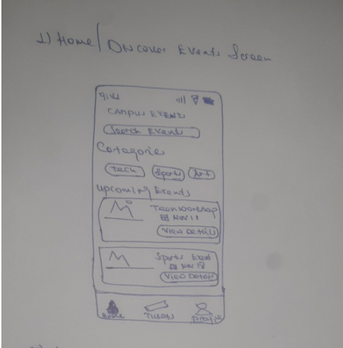
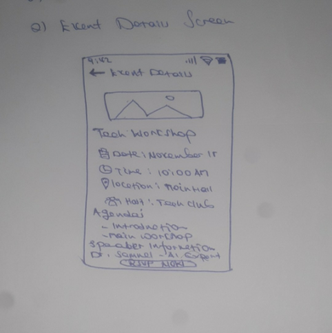
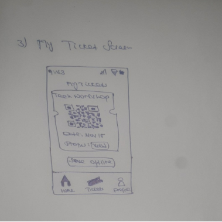
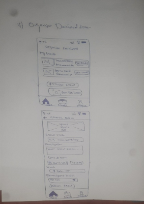

# Project proposal

**Due:** Sunday 8 November 2026 · **Submit:** commit it as `PROPOSAL.md` in the root
of your group's repository and tag that commit `proposal`

Replace every *italic* instruction with your own text. Keep the whole
proposal under four pages.

---

## 1. Title and one-sentence description

Campus Events and Clubs: An app that helps university students with discovering college activities so that they can engage with campus communities.

## 2. Group

| Name | Role |
|---|---|
| Mikiyas Alemayehu | Team Lead & Backend |
| Yosef Ayele | Backend & Testing |
| Nahom Desta | UI/UX |
| Yonathan Markos | UI/UX & Testing |


## 3. The problem

University campuses host academic seminars, hackathons, cultrual festivals and sports comeptitions. Despite this, a large portion of students remain uninformed and disconnected from campus life. Information is framgmented across telegram channels, unofficial social media accounts and paper posters.

Currently, students track campus activities through word of mouth or telegram channels.Club executives struggle just as much, as they must print physical flyers and have no reliable channel to announce last-minute room or schedule changes.

A dedicated mobile app solves this by consolidating campus life into a single pocket dashboard allowing students to track events and activities anywhere from their mobile phones.

## 4. Users

User 1: Students: undergraduate student seeking to expand their social circle and build technical or extracurricular skills.
-Wants to easily browse events by interest (tech, arts, sports), RSVP with one tap, and receive calendar reminders.
- frequency of use would be 3 to 5 times a week to check what is happening around campus.
User 2: Club Organizer: A student club leader responsible for planning workshops and tracking turnout.
-  Wants to publish new events, update venue and timing information, broadcast urgent notices, and verify attendee tickets at the door.
- Frequency of use is daily during the week leading up to an event, and heavily during event day for check-ins.
User 3:  Campus Department Coordinator: A university staff member or department administrator who reviews student activity requests and room bookings.
- Wants an overview of scheduled campus activities to prevent scheduling collisions and double-booking of shared halls.
Frequency of use is once or twice a week.

## 5. User stories

1. As a student (general attendee), I want to browse and filter upcoming campus events by category (tech, social, career, arts, and sports) so that I can quickly find activities matching my interests. (must)
2. As a student (general attendee), I want to view full event details, including the venue, schedule, club host, agenda, and speaker biography, so that I can decide whether to attend. (must)
3. As a student (general attendee), I want to RSVP for an event and receive a digital ticket with a QR code so that I can secure my entry. (must)
4. As a club organizer, I want to create, edit, and publish event listings with photos, venue tags, and participant limits so that I can attract attendees and manage event registration. (must)
5. As a student (general attendee), I want to access my saved tickets and event details offline so that I can show my pass at the venue entrance even when campus Wi-Fi is unavailable. (must)
6. As a club organizer, I want to scan student ticket QR codes using my phone camera so that I can verify tickets and track attendance quickly without using paper registration sheets. (should)
7. As a student (general attendee), I want to receive AI-generated summaries and key takeaways of lengthy event descriptions so that I can understand important information without reading the entire description. (should)
8. As a student (general attendee), I want to view event venue locations on an interactive campus map so that I can easily navigate unfamiliar campus locations. (could)

## 6. Screens

| Screen | Purpose | User stories |
|---|---|---|
|Splash / Welcome Screen | Displays the application logo and introductory information when users open the app.|General navigation |
| Login / Registration Screen  |  Allows students and organizers to create accounts and securely log in.  | Supports all user stories |
| Home / Discover Events Screen | Displays upcoming and featured campus events with category filters and search functionality | 1 |
| Event Details Screen | Displays event descriptions, venue, date, schedule, host club, agenda, and speaker information. | 2, 7, 8 |
| RSVP Confirmation Screen | Allows students to register for an event and confirms successful registration. | 3 |
| My Tickets Screen | Displays registered events and their digital QR-code tickets. | 3,5 |
| Offline Tickets Screen | Provides access to previously saved tickets and event details without an internet connection. | 5 |
| Organizer Dashboard Screen | Gives club organizers an overview of their published events, registrations, and attendance. | 4, 6 |
| Create / Edit Event Screen | Allows organizers to create, edit, and publish event listings, upload photos, set venues, and define participant limits. | 4 |
| QR Code Scanner Screen | Uses the phone camera to scan and verify attendee tickets while recording attendance. | 6 |
| AI Event Summary Screen | Displays concise AI-generated event descriptions and important takeaways. | 7 |
| Campus Map Screen | Shows event venues using interactive map pins to help students navigate campus. | 8 |
| Profile / Settings Screen | Allows users to manage their profiles, preferences, notifications, and account settings. | Supports all user types |
| Department Schedule Overview Screen | Allows faculty or administrative coordinators to view scheduled campus activities and identify venue scheduling conflicts. | Department coordinator needs |

Sketches 
1. Home/Discover Event Screen



2. Event Details Screen 



3. My Tickets Screen



4. Organizer Dashboard / Create Event Screen



## 7. Data model

*The main entities and their fields, and how they relate. A simple
diagram or a list such as:*

```
User: id, fullName, email, programme, role, createdAt
Club: id, name, description, organizerId
Event: id, title, description, category, startDateTime, endDateTime, agenda, speakerName, speakerBio, imageUrl, participantLimit, organizerId, clubId, venueId
Venue: id, name, building, room, capacity, latitude, longitude
Registration: id, userId, eventId, registeredAt, status
Ticket: id, registrationId, qrCodeValue, issuedAt, status, checkedInAt
```
Relationships Between Entities
1.A User can organize multiple events.
2.A Club can organize multiple events.
3.An Event belongs to one club and is assigned to one venue.
4.A User can register for multiple events.
5.An Event can have multiple registrations.
6.Each Registration generates one digital ticket.
7.A Venue can host multiple events at different times.

## 8. Data sources

*Which data is stored locally (and with what: shared_preferences, drift)?
Which comes from a REST web service (one you build or find), and which
from Firebase (Auth, Firestore)? Every project needs local persistence, a
REST source and Firebase.*

## 9. Device feature and AI feature

*Every project needs one device feature (camera, location or a sensor)
**and** one AI feature (for example a summary or a suggestion). For each,
say which user story needs it. For the device feature, say which
permissions it asks for; for the AI feature, what data is sent and to
whom.*

## 10. Risks

| Risk | Likelihood | Plan |
|---|---|---|
| Campus Wi-Fi or internet access may be unavailable when students need to display tickets or organizers need to check attendees in. | Medium | Store issued tickets and essential event details on the device for offline access. Make sure QR tickets can be displayed without a connection. If live verification is unavailable, provide an organizer with a saved attendee list for manual checking. |
| A third-party map service may be unavailable, require payment, or have usage limits. | Medium | Keep the campus map feature optional, as it is a “could-have” story. Use a simple campus map image with venue markers as a fallback, and do not make event discovery or ticket access depend on the map service. |
| AI-generated summaries may omit or misstate important event details. | Medium | Keep the original event description visible and treat summaries as optional. Prompt the AI to summarize only the supplied description, and review sample summaries for accuracy before release. |
| QR scanning may fail because of poor lighting, camera permissions, or damaged screens. | Medium | Request camera permission clearly, provide guidance for improving scan conditions, and let organizers search for or manually verify an attendee’s registration as a fallback. |
| The team may have less development time during exams or other coursework. | High | Complete event browsing, details, RSVP, tickets, and offline ticket access first. Treat QR scanning, AI summaries, and the campus map as lower priority, and reduce or defer these if the core features fall behind. |

## 11. Milestone plan

Milestone 1 — Week 6: Screens, navigation, and in-memory state
Build the main screens and connect them with working navigation. Use sample events and in-memory data to demonstrate the core user flows:
- Browse and filter events by category; open an event’s details.
- RSVP and show a confirmation and sample digital ticket.
- View the student’s tickets.
- Navigate to organizer screens and demonstrate creating or editing an event.
- Show a department schedule overview with sample bookings to illustrate how a coordinator can spot potential conflicts.
Milestone 2 — Week 10: Real data
Connect the app to persistent data so that event and registration information is saved and retrieved. Complete the core “must-have” stories with real data:
- Browse and filter events; view full event details.
- Create, edit, and publish event listings, including photos, venue information, and participant caps.
- RSVP and issue a digital ticket with a QR code.
- Save tickets and essential event details locally so students can access them offline.
The department schedule overview should use the same saved event and venue data where feasible. Test the core flows with realistic sample accounts and events.
Final submission — Week 14: Complete and verified release
Polish the core features, fix issues found during testing, and demonstrate the complete student and organizer flows. If time and technical feasibility allow, add the “should-have” QR check-in and AI event summaries, followed by the “could-have” interactive campus map. Include documentation of testing, known limitations, and the required AI_USAGE.md disclosure with the final submission.

## 12. AI-use plan

The group may use ChatGPT, Gemini, Claude, or a similar assistant to explain unfamiliar concepts, suggest boilerplate, review code the group has written, and help draft test cases. AI-generated work will be treated as a draft: the group will verify it, make sure it is secure and correct, and ensure every member can explain the code they submit.
We will not use AI during supervised exams, quizzes, or lab exit tasks. We will not share API keys, student data, or other private information with AI tools. We will disclose AI use in the required AI_USAGE.md for each milestone and the final submission, including what we used it for, what we checked, and any mistakes or changes. If we keep a substantial AI-generated block of code, we will attribute it in a code comment as required by the course policy.

